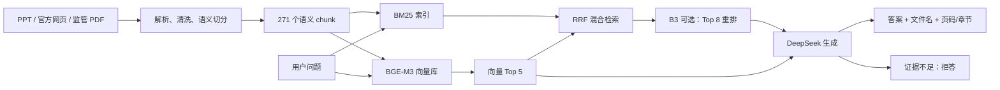
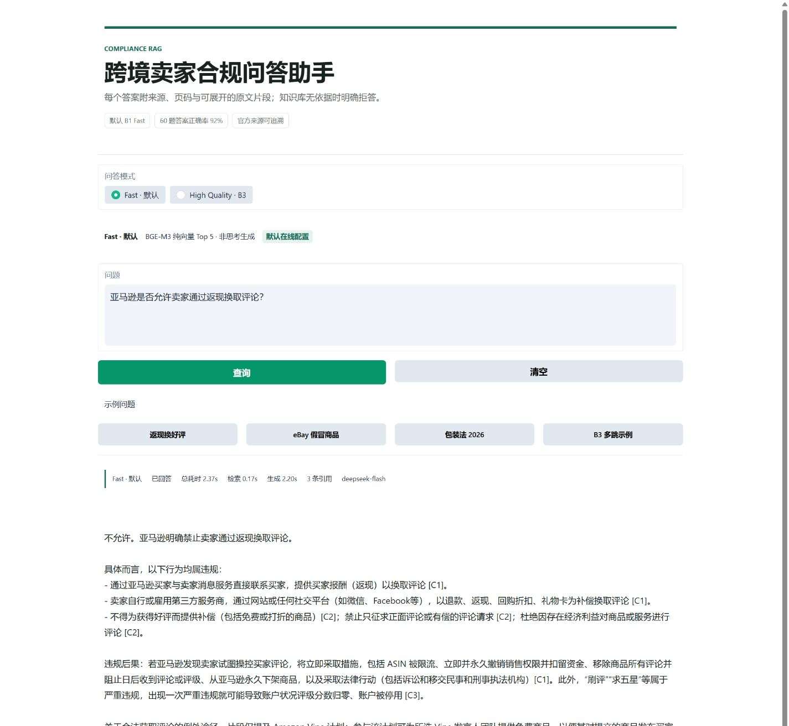

# 跨境卖家合规问答助手

**Version 2.0.0** · [GitHub Release](https://github.com/BBcxy1634/compliance-qa/releases/tag/v2.0.0) · [v1.0.0](https://github.com/BBcxy1634/compliance-qa/releases/tag/v1.0.0)

一个可追溯的 RAG 项目：从 7 份自建 PPT、Amazon/eBay 官方政策和海关监管文件中检索依据，生成带来源和页码的合规答案；证据不足时明确拒答。

## Agentic Compliance Copilot v2

V2 在不改变 B1 Fast 默认路径和原有评价口径的前提下，增加了受控 Agentic RAG
应用层：

- FastAPI 同步接口 `POST /api/v1/answer` 和 SSE 接口
  `POST /api/v1/answer/stream`。
- LangGraph 六节点状态机，确定性路由为
  `high_risk > multi_hop > simple_fact`。
- 有界工具调用，包括来源检索、最新快照检查、版本比较和有效期校验。
- 可选 `X-Session-ID` 短期上下文，最多保留 4 轮最近对话，不持久化。
- 高风险问题至少引用两个不同来源；引用必须真实出现在答案正文中。
- 默认关闭的本地 JSONL Trace，写盘失败不会影响 API 或 SSE。
- 150 题 Phase 4 评测集和独立的 agentic 指标层。
- Docker Compose 单服务打包、GitHub Actions 确定性测试和评测 smoke。

当前 V2 自动化指标中的新增评测标签仍为 `draft`。独立人工复核没有执行，
不能将自动判题或 draft 标签描述为人工通过。Phase 6 已完成 150 题
B1 Fast 付费自动评测，150/150 请求成功，答案正确率 0.8077，引用准确率
1.00，拒答准确率 1.00。

API、图状态和工具契约见 [API](docs/agentic_v2/API.md)、
[Graph](docs/agentic_v2/GRAPH.md) 和 [Tools](docs/agentic_v2/TOOLS.md)。
V2 架构、部署与限制分别见
[Architecture](docs/agentic_v2/ARCHITECTURE.md)、
[Deployment](docs/agentic_v2/DEPLOYMENT.md) 和
[Limitations and failures](docs/agentic_v2/LIMITATIONS_AND_FAILURES.md)。

### V2 150 题自动评测

运行 `phase6_b1_fast_150` 使用 B1 Fast、质量优先证据选择和 DeepSeek 自动判题。
150 个请求全部完成，0 个失败请求。

| 指标 | 结果 |
|---|---:|
| Hit@5 | 1.0000 |
| Gold unit recall@5 | 0.9462 |
| 引用准确率 | 1.0000 |
| 答案正确率 | 0.8077 |
| 事实题正确率 | 0.8286 |
| 多跳题正确率 | 0.7833 |
| 拒答准确率 | 1.0000 |
| Agentic 路由准确率 | 0.9933 |
| 工具选择准确率 | 1.0000 |
| 工具成功率 | 0.9915 |
| 多步完成率 | 0.7500 |
| 证据充分性准确率 | 0.9867 |

结果文件位于
[`eval/results/phase6_b1_fast_150/summary.json`](eval/results/phase6_b1_fast_150/summary.json)。
该结果是自动判题结果，不代表人工复核通过。

## 系统架构



默认系统使用 **B1 Fast**：语义切分、BGE-M3 纯向量 Top 5、无重排、DeepSeek 非思考模式、输出上限 600 token。

B3 是可选高质量模式：混合检索 Top 8 后使用 `BAAI/bge-reranker-v2-m3` 精排到 Top 5，再交给 DeepSeek。它提升多跳题表现，但 CPU 延迟较高。

## 评测指标

评测集为冻结的 60 题：40 事实、10 多跳、10 拒答。B0-B3 均使用相同的 DeepSeek 生成 Prompt 和自动判题口径。

| 版本 | 切分 | 检索 | 重排 | Hit@5 | 引用准确率 | 答案正确率 | 事实题 | 多跳题 | 拒答准确率 |
|---|---|---|---|---:|---:|---:|---:|---:|---:|
| B0 | 固定 512 | 向量 Top 5 | 无 | 1.00 | 1.00 | 0.82 | 0.85 | 0.70 | 1.00 |
| B1 | 语义切分 | 向量 Top 5 | 无 | 1.00 | 1.00 | 0.90 | 0.925 | 0.80 | 1.00 |
| B2 | 语义切分 | 混合 RRF Top 5 | 无 | 1.00 | 1.00 | 0.90 | 0.95 | 0.70 | 1.00 |
| B3 | 语义切分 | 混合 RRF Top 8 | BGE reranker | 1.00 | 1.00 | 0.94 | 0.95 | 0.90 | 1.00 |

生产候选 B1 Fast 的 60 题答案正确率为 0.92，100 次压测平均延迟 1.92 秒、平均成本约 ¥0.0010，但 P95 为 3.31 秒，尚未完全满足 3 秒目标。

指标由 [evaluate.py](evaluate.py)、[src/evaluate.py](src/evaluate.py) 和 [bench.py](bench.py) 生成。自动判题结果尚未经过人工复核，最终报告需保留这一限制。

## 三个典型 Badcase

| 题目 | 类型 | 现象 | 修法 |
|---|---|---|---|
| q023 | 生成不完整 | 找到 eBay 评价政策，但只回答仇恨内容可移除，漏掉亵渎/露骨内容。 | 并列政策项做关键事实后检，缺失时触发补充生成。 |
| q032 | 召回噪声 | 找到增加 29 项的 chunk，但删除项和税则调整所在的 c02 被无关海关页面挤出 Top 5。 | 同 source 相邻 chunk 扩展，并限制无关来源占用。 |
| q049 | 召回噪声 | 找到商品描述语言政策，但 search manipulation 官方政策缺失，混入运营 PPT 和成人商品政策。 | 多意图拆分检索，平台政策题优先官方来源。 |

完整 22 个失败实例和修法见 [D10 Badcase 分析](docs/d10_badcase_analysis.md)。

## 快速开始

先安装 Python 3.12+，并把 `.env.example` 复制为 `.env`，填写 DeepSeek Key。之后在项目根目录执行三条命令：

```powershell
python -m pip install -r requirements.txt
python scripts/bootstrap.py
python -m src.rag "eBay 是否允许销售假冒商品？" --mode deepseek --no-thinking --max-tokens 600
```

`bootstrap.py` 会下载缺失的官方语料，执行解析和语义切分，建立默认 B1 向量库，并校验来源与评测集。BGE-M3 首次下载约 4.3 GB，不计入“10 分钟复现”时间。

完整复现 B0-B3、下载 reranker 和生成冻结指标：

```powershell
python scripts/bootstrap.py --full --with-reranker
python evaluate.py --config eval/configs/b1_fast.yaml --chunks data/processed/chunks.jsonl
python evaluate.py --config eval/configs/b3_deepseek.yaml --chunks data/processed/chunks.jsonl
```

验证安装：

```powershell
python scripts/check_environment.py --require-data
python -m pytest -q
```

## V2 API

完成数据准备并在 `.env` 配置 `DEEPSEEK_API_KEY` 后启动 API：

```powershell
.\.venv\Scripts\python.exe -m uvicorn src.api:app --host 127.0.0.1 --port 8000
```

健康检查与同步问答：

```powershell
Invoke-RestMethod http://127.0.0.1:8000/health
Invoke-RestMethod `
  -Method Post `
  -Uri http://127.0.0.1:8000/api/v1/answer `
  -ContentType "application/json; charset=utf-8" `
  -Body '{"question":"eBay 是否允许销售假冒商品？","mode":"fast"}'
```

流式接口返回 `start`、`status`、`token`、`done` 或 `error` SSE 事件。
`citations` 只在 `done` 事件中返回，并且仅包含正文实际使用的引用。

## Docker Compose

Docker 镜像只启动 FastAPI；不增加 Qdrant、PostgreSQL 或 Redis。Compose 使用
宿主机已有的 `data/` 和 `chroma_db/` 只读挂载，模型缓存与 Trace 使用命名卷。

先在本机完成一次数据准备：

```powershell
python scripts/bootstrap.py
```

再启动：

```powershell
docker compose up --build -d
docker compose ps
Invoke-RestMethod http://127.0.0.1:8000/health
```

停止服务：

```powershell
docker compose down
```

干净的 Git checkout 不包含官方 HTML/PDF、处理后的 chunks 或 Chroma 数据库。
因此容器健康检查可以启动，但真实问答前必须先在宿主机完成
`bootstrap.py`。Docker 中 `TORCH_DEVICE` 默认是 `cpu`；B3 仍可显式选择，
但 CPU 延迟较高。

Trace 默认关闭。若在 `.env` 设置 `TRACE_ENABLED=true`，容器会写入
`/app/.cache/traces` 命名卷。目录不可写时 TraceStore 会自行关闭，不会阻止
API 启动或改变回答响应。完整说明见
[部署文档](docs/agentic_v2/DEPLOYMENT.md)。

## 语料来源与版权

- 7 份自建跨境业务 PPT 用于背景知识与操作流程。
- 12 个 Amazon/eBay 官方政策页用于平台规则回答。
- 5 份海关、财政、商务和税务公开文件用于监管问题。

官方正文、PDF 和 chunk 仅用于本地实验，版权归原发布方，不提交到公开 Git 仓库。所有来源 URL、抓取日期和哈希记录在 [sources.jsonl](data/raw/sources.jsonl)。详细来源见 [官方来源清单](docs/official_sources.md)。

## 默认模式与高质量模式

| 模式 | 配置 | 适用场景 | 质量 | 延迟 |
|---|---|---|---:|---:|
| B1 Fast | 语义切分 + 向量 Top 5 + 非思考生成 | 默认在线问答 | 0.92 | P95 3.31 秒 |
| B3 | 混合检索 Top 8 + BGE reranker | 多跳、低置信、高风险问题 | 0.94 | CPU P95 约 12 秒 |

B3 **不是最终默认配置**，而是项目的质量上限实验和可选高质量模式。

## Gradio Demo

在 `.env` 配置 `DEEPSEEK_API_KEY` 后启动：

```powershell
.\.venv\Scripts\python.exe app.py --port 7860
```

浏览器访问 `http://127.0.0.1:7860`。页面默认使用 B1 Fast，也可以切换到 B3 高质量模式。第一次加载 B3 reranker 时，CPU 环境可能额外等待约 30 秒。



Demo 提供 Fast 正常回答、无依据拒答、B3 多跳和移动端布局验证。完整演示题、3 分钟讲解脚本和视频录制步骤见 [D13 Demo 指南](docs/d13_demo.md)。

## GPU 模式

当前代码会自动检测 CUDA：

```dotenv
TORCH_DEVICE=auto
```

有可用 GPU 时自动使用 CUDA，否则回退 CPU。如需强制检查 CUDA：

```dotenv
TORCH_DEVICE=cuda
```

要求：

- NVIDIA GPU，建议至少 8 GB 显存，12 GB 更稳妥。
- 安装与驱动匹配的 CUDA 版 PyTorch，不能用当前 CPU-only wheel。
- 验证 `python -c "import torch; print(torch.cuda.is_available())"` 返回 `True`。

CPU 上 B3 的 P95 约为 12.3 秒，其中重排约 8.7 秒。GPU 上预计重排 P95 可降至约 0.3 至 1 秒，但这是容量估算，必须用目标显卡重新运行 100 次 benchmark。当前 DeepSeek 生成仍可能使 P95 保持在 4 秒左右。

详细复现与 GPU 说明见 [D12 复现指南](docs/d12_reproducibility.md)。

## 项目结构

```text
compliance-qa/
├─ data/raw/                 # PPT、官方网页、PDF 和来源清单
├─ data/processed/           # 语义/B0 chunks
├─ eval/
│  ├─ questions.jsonl        # 冻结的 60 题
│  ├─ configs/               # B0-B3、B1 Fast
│  ├─ results/               # 评测结果和 badcase
│  └─ bench/                 # 100 次延迟与成本结果
├─ src/                      # ingest / embed / retrieve / generate
├─ scripts/                  # 抓取、校验、复现和报告脚本
├─ evaluate.py               # 60 题评测入口
├─ bench.py                  # 100 次成本与延迟压测
└─ report.md                 # 一页评测报告
```

完整版本说明见 [CHANGELOG.md](CHANGELOG.md)，最终交付和验收信息见 [D15 最终交付说明](docs/d15_final_delivery.md)。

## 当前限制

- B1 Fast P95 为 3.31 秒，尚未完全达到 3 秒目标。
- B3 CPU 延迟过高，只适合按需启用。
- q032、q049 仍存在精确 chunk 覆盖不足。
- 自动判题结果尚未完成人工复核。
- Demo 为单轮问答，不保存会话历史；B3 首次加载在 CPU 上较慢。
- V2 的 150 题新增标签是 `draft`，没有人工通过结论。
- V2 质量优先路径 P95 为 10.07 秒，多跳题正确率为 0.7833。
- 当前轮次没有实际启动 Docker 容器；远程 GitHub Actions 已通过。
- 短期会话、Trace 和模型缓存没有实现多实例共享。

## 许可证与数据权利

项目源代码和原创文档采用 [MIT License](LICENSE)。

`data/raw/ppt` 中的 7 份 PPT 是项目维护者确认可用于本项目的材料，随仓库提供，但不自动纳入 MIT 授权范围。PPT 中可能包含的第三方商标、图片、字体或引用仍归原权利人所有。

Amazon、eBay 官方网页，海关和商务公告及其 PDF 不提交到仓库；使用时须遵守原发布方的版权和使用条款。详细说明见 [NOTICE.md](NOTICE.md)。
