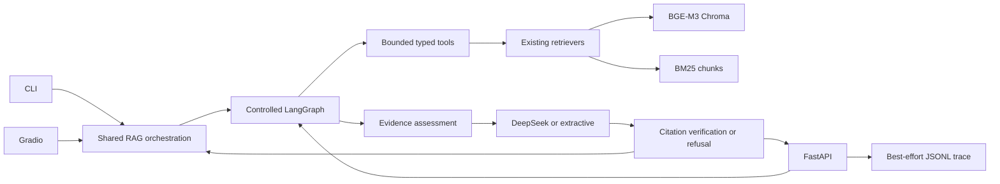

# Agentic Compliance Copilot v2 Architecture

## Scope

V2 upgrades the existing compliance RAG application with a controlled Agentic
RAG layer. It keeps Chroma, the existing BGE-M3 and BM25 retrieval paths, the
existing generator, CLI, and Gradio app. No additional database or queue is
introduced.

## Runtime Topology

The synchronous API and SSE endpoint execute the same graph. SSE adds custom
graph events for retrieval, generation, tokens, and citation verification, but
does not create a second answer path.

## Application Layers

| Layer | Responsibility |
|---|---|
| Entry points | FastAPI, SSE, CLI, and Gradio |
| Orchestration | Six-node LangGraph with no loop edges |
| Tools | Search, snapshot inspection, version comparison, validity check |
| Retrieval | Existing BGE-M3 Chroma and BM25 paths |
| Generation | Existing DeepSeek or extractive generator |
| Safety | Evidence gate, high-risk source rule, refusal, citation filtering |
| Context | Bounded process-local sessions, no long-term memory |
| Observability | Allowlisted local JSONL traces, best effort only |

## Data Boundary

Tracked repository content contains PPT materials, source metadata, evaluation
sets, and derived reports. The following remain local and are excluded from Git
and the Docker build context:

- `.env` and API keys
- official HTML/PDF snapshots
- processed chunk JSONL
- Chroma collections
- model caches
- runtime evaluation and trace outputs

Compose mounts `data/` and `chroma_db/` read-only. A clean checkout can start
the health endpoint, but answers require a host-side `bootstrap.py` run first.

## Request Flow

1. Validate the question, mode, and optional session ID.
2. Classify with deterministic `high_risk > multi_hop > simple_fact` rules.
3. Rewrite a follow-up or split a multi-hop question into at most three queries.
4. Run bounded search and optional metadata tools.
5. Assess evidence with the existing thresholds.
6. Generate only when evidence is sufficient.
7. Filter citations to IDs present in the answer.
8. Refuse with zero citations if evidence or high-risk source rules fail.
9. Write a sanitized trace only when tracing is enabled.

## Deployment Choices

- One application container exposes FastAPI on port 8000.
- Gradio remains an existing local entry point and is not started by Compose.
- Docker uses a non-root user and pre-created cache/Trace directories.
- Trace and Hugging Face cache use named volumes; corpus and vector data use
  read-only bind mounts.
- No Qdrant, PostgreSQL, Redis, Kubernetes, or hosted Trace service is added.

## Compatibility Boundary

- B1 Fast remains the default.
- B3 remains optional and is not created by the fast graph path.
- Refusals return `refused=true` and no citations.
- Citation IDs are derived from the actual final answer body.
- High-risk answers require two distinct cited sources.
- Existing `src/rag.py` CLI and `app.py` Gradio paths remain available.
- Original evaluation metrics and formulas are unchanged.
