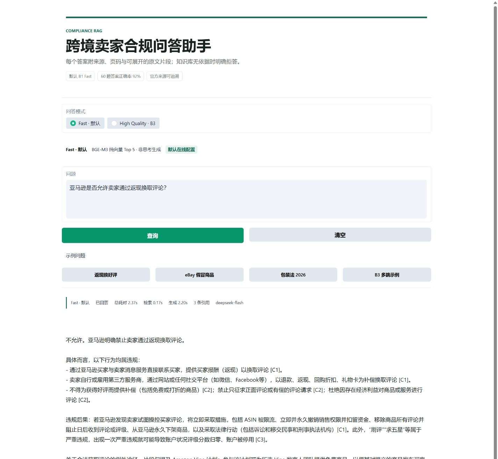
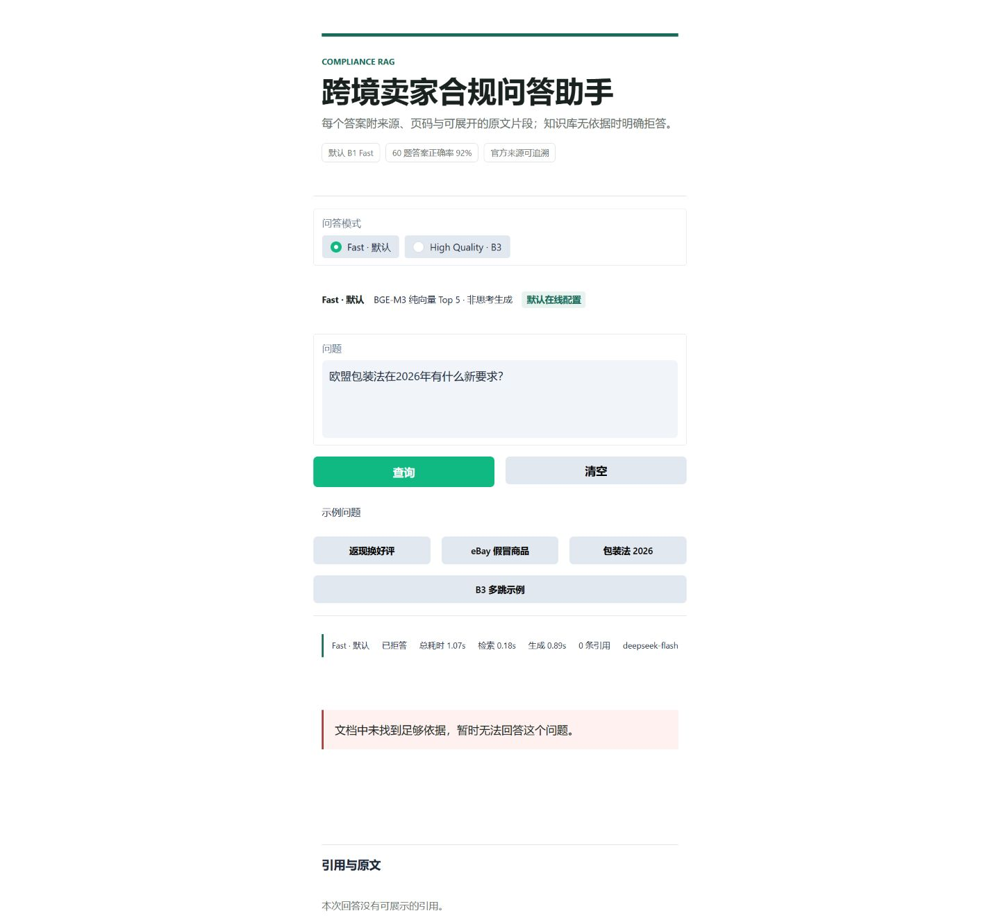
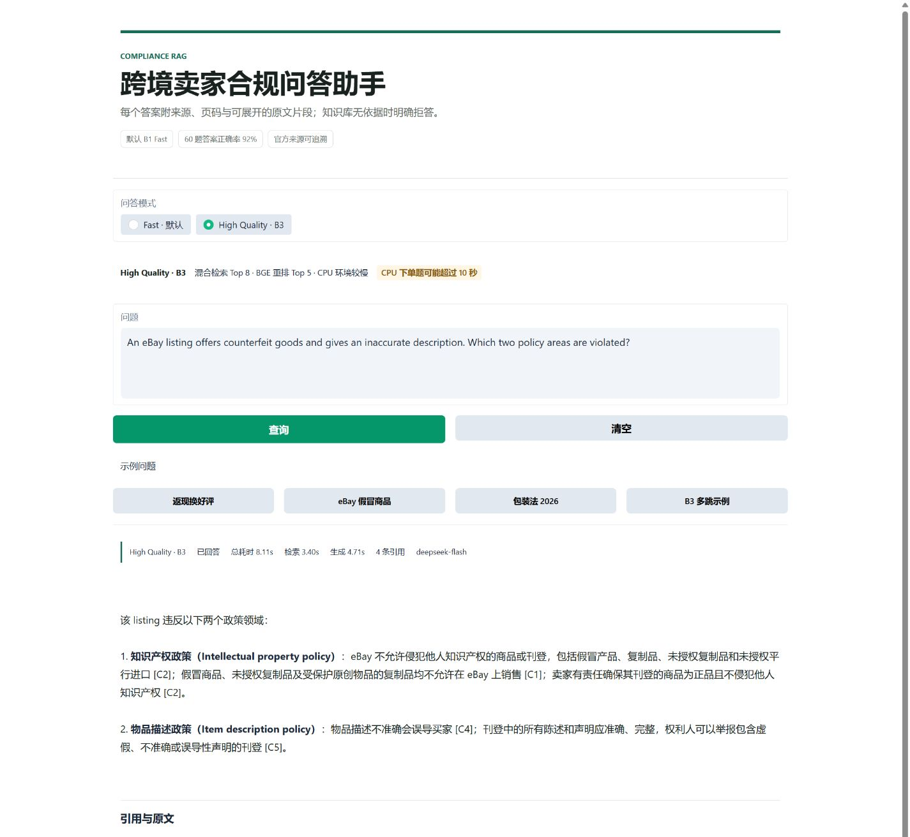
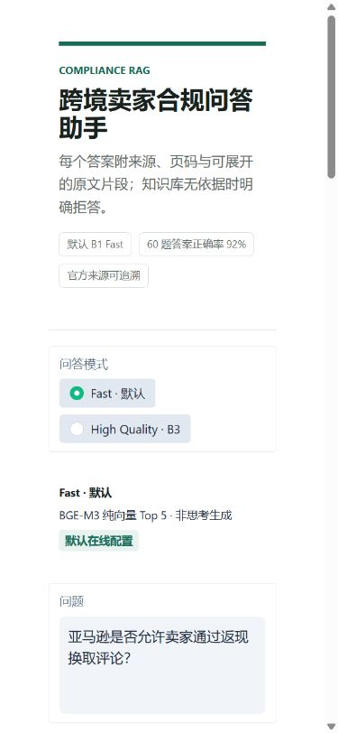

# D13 Gradio Demo 与演示脚本

## Demo 说明

D13 提供一个单页 Gradio Demo，用来演示完整的 RAG 问答链路：

1. 用户提交跨境电商合规问题。
2. Fast 模式使用 BGE-M3 向量检索 Top 5，B3 模式使用混合检索 Top 8 加 BGE reranker 精排 Top 5。
3. DeepSeek 只根据检索到的上下文生成回答。
4. 页面仅展示回答正文实际引用的来源。
5. 文档中证据不足时返回明确拒答，并显示 `0 条引用`。

| 模式 | 检索与生成配置 | 用途 | 当前表现 |
|---|---|---|---|
| Fast（默认） | BGE-M3 向量 Top 5 + DeepSeek 非思考 | 日常演示和在线问答 | 60 题正确率 0.92，CPU P95 3.31 秒 |
| High Quality（B3） | 混合检索 Top 8 + BGE reranker Top 5 + DeepSeek 思考 | 多跳题、高风险或低置信问题 | 60 题正确率 0.94，CPU P95 约 12.31 秒 |

B3 是质量上限实验和可选高质量模式，**不是最终默认配置**。

## 启动

先确认 `.env` 已配置 `DEEPSEEK_API_KEY`，然后在项目根目录执行：

```powershell
.\.venv\Scripts\python.exe app.py --port 7860
```

浏览器打开：

```text
http://127.0.0.1:7860
```

Fast 模型在启动时预热。第一次切换到 B3 时还需要加载 reranker，CPU 环境可能额外等待约 30 秒。

如需跳过启动预热：

```powershell
.\.venv\Scripts\python.exe app.py --port 7860 --no-warmup
```

## 页面功能

- 模式切换：Fast 为默认值，B3 用于可选的高质量演示。
- 示例问题：一键填入返现换评论、eBay 假冒商品、包装法拒答和 B3 多跳题。
- 回答状态：显示模式、是否拒答、总耗时、检索耗时、生成耗时和引用数量。
- 引用卡片：显示实际引用编号、来源标题、文件名、页码/章节和官方 URL。
- 原文展开：点击“查看原文片段”可核对生成答案使用的 chunk。
- 清空：恢复问题、回答、状态和引用区域。

## 演示题目

### Fast 正常回答

```text
亚马逊是否允许卖家通过返现换取评论？
```

预期结果：明确回答“不允许”，并展示评论政策引用。

### 无依据拒答

```text
欧盟包装法在2026年有什么新要求？
```

预期结果：显示“文档中未找到足够依据”，状态为“已拒答”，引用数量为 0。

### B3 多跳回答

```text
An eBay listing offers counterfeit goods and gives an inaccurate description.
Which two policy areas are violated?
```

预期结果：同时使用 eBay 知识产权政策和物品描述政策，给出两个政策领域并显示对应引用。

## 3 分钟演示脚本

| 时间 | 操作 | 讲解重点 |
|---|---|---|
| 0:00-0:25 | 展示首页和顶部指标 | 项目解决跨境卖家规则分散、答案难追溯的问题；默认使用 Fast 模式。 |
| 0:25-1:05 | 点击“返现换好评”并查询 | 说明问题经过 BGE-M3 检索、DeepSeek 生成和引用过滤，指出状态栏的延迟。 |
| 1:05-1:40 | 点击“包装法 2026”并查询 | 说明系统不会为了“有答案”而编造；无可靠证据时拒答，引用数为 0。 |
| 1:40-2:35 | 切换到“B3 多跳示例”并查询 | 说明 B3 先混合召回 8 条，再用 reranker 精排 5 条，适合多跳问题；提前说明 CPU 下较慢。 |
| 2:35-2:55 | 展开一条引用原文 | 展示文件名、官方 URL、页码/章节和 chunk 原文，强调答案可核验。 |
| 2:55-3:00 | 回到结果状态栏 | 总结 B1 Fast 适合默认使用，B3 是可选高质量实验，不把 B3 说成默认生产配置。 |

## 视频录制

推荐使用 Windows 自带的 Xbox Game Bar：

1. 启动 Demo，完成一次 Fast 预热查询。
2. 按 `Win + G` 打开 Game Bar。
3. 在捕获面板中开启麦克风并点击“开始录制”。
4. 按上面的 3 分钟脚本操作，保持鼠标移动平稳。
5. 在 B3 按钮变为选中状态后再点击查询。
6. 录制完成后停止，并在“捕获”文件夹检查视频。
7. 上传前确认画面中没有 `.env`、API Key、浏览器隐私标签或其他敏感信息。

如果需要更高画质或剪辑，可以使用 OBS Studio，但不要在实际演示时临时安装软件。

## 截图









## 当前限制

- Demo 是单轮问答，不保存会话历史。
- 回答质量依赖本地 BGE-M3 向量库、reranker 和 DeepSeek API 可用性。
- B3 在 CPU 上首次加载和单题响应都较慢，演示前应至少预热一次。
- Fast 模式 P95 为 3.31 秒，尚未完全达到 3 秒目标。
- 页面展示的是合规工作参考，不构成法律意见。
